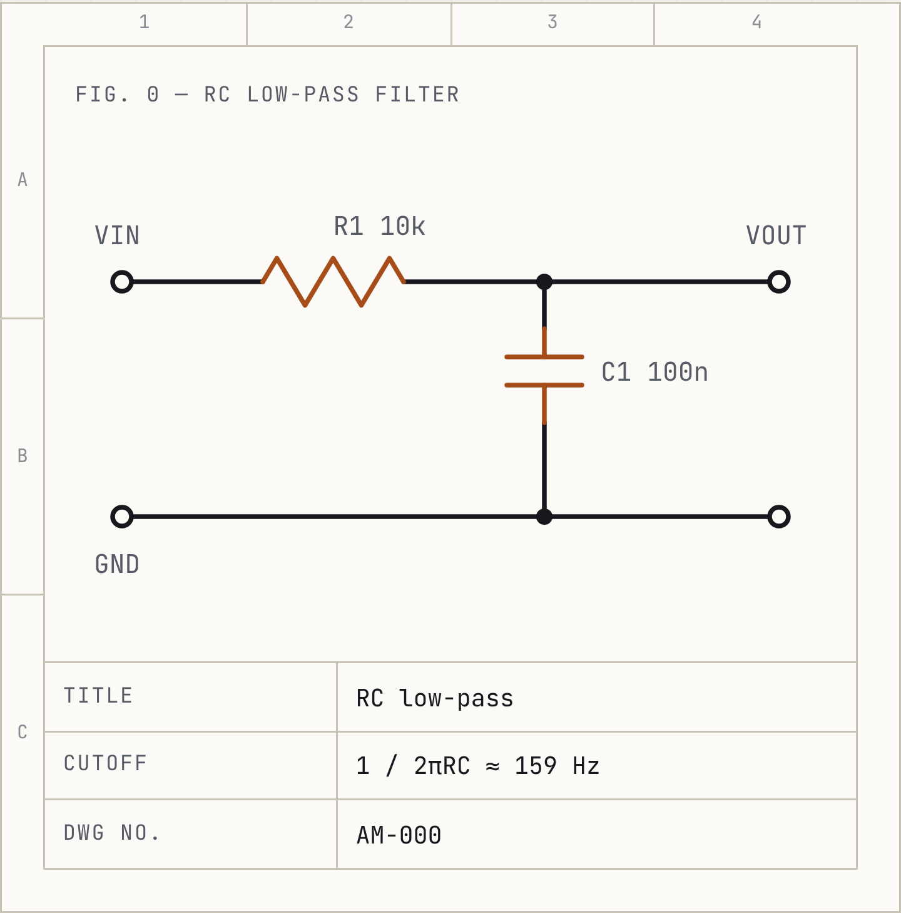

import Figure from '../../components/Figure.astro';
import sampleSchematic from '../../assets/projects/hardware-project-1/sample-schematic.png';

{/* PLACEHOLDER: replace every section below with the real write-up. Delete sections that don't apply. */}

## Overview

What the device does and why you built it.

## Requirements

- Supply voltage / battery life target
- Inputs and outputs (sensors, displays, actuators)
- Size, cost, or other constraints

## System design

Block diagram of the major subsystems (power, MCU, sensors, outputs) and how they connect.

## Schematic & PCB

Schematic and board renders or photos. Call out key choices: regulator selection, decoupling, protection,
trace widths.

<Figure src={sampleSchematic} alt="Sample RC low-pass filter schematic" n={5} caption="Sample figure in the write-up" />

## Bill of materials

| Ref | Part | Value / Package | Qty | Notes |
| --- | ---- | --------------- | --- | ----- |
| U1  | MCU  | —               | 1   | —     |

## Firmware

Language, structure, and the interesting parts (interrupts, state machine, drivers). Link to the repo.

## Testing & results

Measurements: current draw, scope captures, accuracy against a reference. What worked and what didn't.

Plain Markdown images can be zoomed too:

## Next revision

What you would change in rev B.
